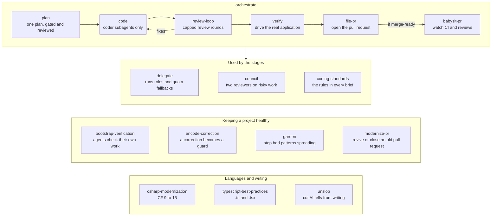

# Agent skills

Skills for Claude Code, Codex, Cursor and other agents that read `SKILL.md` files.

`orchestrate` runs the top row from left to right and uses the second row along the way;
each of those skills also works on its own. The last two rows are separate skills. Rounded
boxes are steps of `orchestrate`, not skills.

Each skill has a short guide in [docs/](docs) that says what it solves, how it works and
how it connects to the others.

| Skill | What it does | Guide |
| --- | --- | --- |
| [orchestrate](skills/orchestrate/SKILL.md) | Runs a plan, code, review loop: one plan with code sketches, all coding delegated to coder subagents, reviews with hard caps, verification in the running app, and a pull request. | [guide](docs/orchestrate.md) |
| [plan](skills/plan/SKILL.md) | Writes one executable plan with code sketches, using the planner role, checks it against a gate and has a reviewer check it against the code before any coding. | [guide](docs/plan.md) |
| [review-loop](skills/review-loop/SKILL.md) | Runs budgeted review rounds with read-only reviewer subagents, a findings ledger with stable ids, and a hard round cap. | [guide](docs/review-loop.md) |
| [council](skills/council/SKILL.md) | Gets two independent reviews on the same diff, plan or document, from the two models you assign to its roles, with a limit of two rounds. | [guide](docs/council.md) |
| [delegate](skills/delegate/SKILL.md) | Runs subagent roles on their configured harnesses and models, with an optional fallback for usage caps. | [guide](docs/delegate.md) |
| [file-pr](skills/file-pr/SKILL.md) | Opens a problem-first pull request with how it was verified, what was not, deferred findings and attribution. | [guide](docs/file-pr.md) |
| [babysit-pr](skills/babysit-pr/SKILL.md) | Watches your pull request through CI and review, triages what arrives, and reports when it is ready, waiting for a human, or blocked. Never merges. | [guide](docs/babysit-pr.md) |
| [modernize-pr](skills/modernize-pr/SKILL.md) | Brings an old pull request up to date and says whether it should still exist: modernize, rework or close. Never merges or closes. | [guide](docs/modernize-pr.md) |
| [coding-standards](skills/coding-standards/SKILL.md) | Coding standards (First make it work, Then make it right, Practice), for writing and reviewing code and for coder briefs. | [guide](docs/coding-standards.md) |
| [bootstrap-verification](skills/bootstrap-verification/SKILL.md) | Sets up a project-specific verification skill so agents can build, run and check an app themselves. | [guide](docs/bootstrap-verification.md) |
| [encode-correction](skills/encode-correction/SKILL.md) | Turns a correction of the agent into a permanent fix in the project, so the same mistake can't happen again. | [guide](docs/encode-correction.md) |
| [garden](skills/garden/SKILL.md) | Finds workarounds, suppressions and competing patterns, checks whether they are spreading, and guards against them before cleanup. | [guide](docs/garden.md) |
| [csharp-modernization](skills/csharp-modernization/SKILL.md) | Modernizes C# code using features from C# 9 through C# 15, with guidance on language versions, runtime requirements and behavior changes. | [guide](docs/csharp-modernization.md) |
| [typescript-best-practices](skills/typescript-best-practices/SKILL.md) | TypeScript best practices for reading and editing `.ts` and `.tsx` files. | [guide](docs/typescript-best-practices.md) |
| [unslop](skills/unslop/SKILL.md) | Cuts AI tells from any writing. | [guide](docs/unslop.md) |

## Install

Run this from your project directory and choose your agent when prompted.

~~~sh
npx skills@latest add fredimachado/skills --skill csharp-modernization
~~~

Add `--global` to make a skill available across projects. Repeat `--skill` to install
several, or use `--skill '*'` for all of them.

The orchestration skills work together: `orchestrate` uses `plan`, `review-loop`,
`council`, `delegate`, `file-pr`, `babysit-pr` and `coding-standards`. Install them as a
set:

~~~sh
npx skills@latest add fredimachado/skills --global --skill orchestrate --skill plan --skill review-loop --skill council --skill delegate --skill file-pr --skill babysit-pr --skill coding-standards
~~~

`delegate` reads a role file at `~/.agents/roles.json` that names the harness and model
for each role. The install scripts under "Working on this repository" ask for them, offer
the models in [scripts/models.txt](scripts/models.txt) by number, and write it; otherwise
copy [roles.example.json](skills/delegate/roles.example.json) there and fill it in. Give
each model exactly as its harness takes it (an id or alias, not a display name): Codex
lists them with `codex debug models`, Cursor with `cursor-agent --list-models`, and
Claude Code with `/model`. Cursor models carry their effort in the name. Each role can
have one fallback with its own harness, model and effort. It runs on a confirmed usage
cap. A host override replaces the whole role, including its fallback.

`delegate` and `babysit-pr` come with scripts: PowerShell 7 on Windows, plain `sh` with
`jq` on Linux and macOS (`babysit-pr` also needs `gh`). `encode-correction`, `garden` and
`bootstrap-verification` come with Python 3 scripts that use only the standard library;
the browser driver `bootstrap-verification` can add to a project needs Playwright, and
its terminal driver needs tmux.

## Update

Run the same install command again to fetch the current version. Use the same project
directory or the same `--global` option as before.

## For agents installing these skills

If someone asks you to install this repository's skills:

1. **Use one route.** Use `npx skills` unless they say they will work on this repository;
   then clone it and run the install script instead (see "Working on this repository").
   Never run both: `npx skills` replaces the script's links with copies, and the clone stops
   updating what the harnesses read. Use APM only if they ask for it.
2. **Ask which harnesses and which skills**, then run the command without prompts. For all
   skills on all three harnesses:

   ~~~sh
   npx skills@latest add fredimachado/skills --global --skill '*' -a claude-code -a codex -a cursor -y
   ~~~

   Drop an `-a` for a harness they don't use, or name skills with `--skill` instead of `'*'`.
3. **Set up the roles if they installed `delegate`** (or `orchestrate`, `plan`, `council`,
   `review-loop` or `babysit-pr`, which use it). Never choose models yourself. If they
   have a clone and a terminal, tell them to run `install.ps1 -Roles` or
   `install.sh --roles`. Otherwise ask
   them, for each role (planner, coder-simple, coder-complex, reviewer, council-a,
   council-b): the harness (claude, codex or cursor); the model, offering the names listed
   for that harness in [scripts/models.txt](scripts/models.txt) or one they type exactly;
   and an effort level, except for Cursor, whose models carry the effort in the name.
   Offer the same choices for one optional usage-quota fallback. Then
   ask whether any harness should use different roles when it runs the session (host
   overrides). Write `~/.agents/roles.json` in the shape of
   [roles.example.json](skills/delegate/roles.example.json). If the file exists, show them
   the change before writing and keep the old one as `roles.json.bak`.
4. **Check the result:** list `~/.claude/skills` and `~/.agents/skills`, and tell them to
   start a new session in each harness so it loads the skills.

## Install with APM

[APM](https://github.com/microsoft/apm) installs the same skills from this repository and
pins the version in a lock file. Install one skill:

~~~sh
apm install fredimachado/skills --skill csharp-modernization
~~~

Add `-g` to install for your user instead of the project, and `--target claude,codex,cursor`
to choose the harnesses. Repeat `--skill` for more skills, or leave it out for all of them.
`apm update` moves to the current version.

## Use

Ask your agent for what you want; each skill's description says when it applies. For
example, "Use csharp-modernization to simplify this class while keeping it compatible with
C# 12", or "Orchestrate this feature with coders".

## Working on this repository

Clone it and link the skills into the folders the harnesses read, so edits take effect at
once:

| | Windows (PowerShell 7) | Linux and macOS (sh) |
| --- | --- | --- |
| Link every skill into `~/.claude/skills` and `~/.agents/skills`; offer to set up `~/.agents/roles.json` when it is missing | `scripts/install.ps1` | `scripts/install.sh` |
| Change the models in `~/.agents/roles.json` | `scripts/install.ps1 -Roles` | `scripts/install.sh --roles` |
| Install the third-party skills in `apm/apm.yml` with APM | `scripts/sync-apm.ps1` | `scripts/sync-apm.sh` |

`install` never replaces a real folder or a link that points elsewhere: it reports them
and skips them. For the role file it asks, per role, for the harness, the model (a number
from the list in `scripts/models.txt`, or any model typed) and an optional effort, except
for Cursor, followed by an optional fallback (Enter keeps the current value, `-` clears it), then for any host
overrides, shows the result and writes it only after you confirm, keeping the previous
version as `roles.json.bak`. The `.sh` version needs `jq` for this. `sync-apm` offers to
install APM when it is missing, showing the command first. Tests are in `tests/` (Pester 5): the `.ps1` scripts are tested on Windows and the
`.sh` scripts on Linux and macOS. `tests/skill-text.Tests.ps1` checks, on all three, that
the skills name only files and sections that exist, that this README lists every skill in
its table and its diagram, and that every skill has a guide in `docs/` whose links work.
The test cannot tell whether the diagram and the guides are still true: read them again
with every change to a skill.

## Credits

`modernize-pr`, and several rules in the review and pull request skills, come from
[tstack](https://github.com/t3dotgg/tstack) (MIT). The review of a plan against the
code, the bar a reviewer's finding must meet, the baseline for failures, and several rules
for coder briefs and pull request descriptions follow [graft](https://github.com/pleb/graft)
(MIT).
